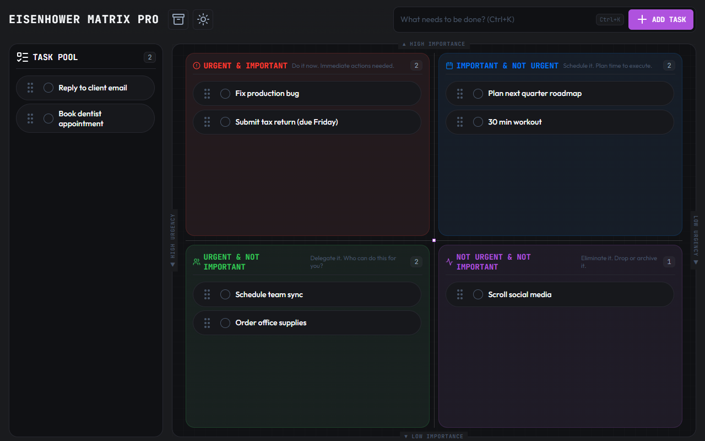

# Eisenhower Matrix Pro

**Eisenhower Matrix Pro (Ehmatrix) is a free, browser-based Eisenhower matrix to-do app that lets you drag tasks into four urgency and importance quadrants (Do, Schedule, Delegate, Eliminate) and keeps everything in your browser with no account.**

<p align="center">
  <a href="https://ehmatrix.codingmarvel.com"></a>
  
  
  
  
</p>

<p align="center">
  <a href="https://ehmatrix.codingmarvel.com">
    
  </a>
</p>

<p align="center"><a href="https://ehmatrix.codingmarvel.com"><b>Open the app</b></a></p>

## Why Eisenhower Matrix Pro

- **No sign-up, no server.** Tasks are saved in your browser's `localStorage` under one key. The app is a static single-page site with no backend and no API calls.
- **1 pool + 4 quadrants.** Type a task into the Task Pool, then drag it into Urgent & Important, Important & Not Urgent, Urgent & Not Important, or Not Urgent & Not Important.
- **Add a task in one keystroke.** Press `Ctrl+K` (or `Cmd+K` on macOS) from anywhere to jump to the input, type, and hit Enter.
- **Nothing is lost when you finish.** Completed tasks move to an archive grouped by completion date, where you can restore them to the board or delete them for good.
- **Small footprint.** Only 5 runtime dependencies: React, React DOM, TanStack Query, lucide-react icons and canvas-confetti.

## Features

### Prioritize with the Eisenhower matrix
- Four color-coded quadrants laid out on a graph with labeled axes: high to low importance (vertical) and high to low urgency (horizontal).
- Each quadrant carries its action: **Do it now**, **Schedule it**, **Delegate it**, **Eliminate it**.
- Live task counts on the pool and on every quadrant.
- Native drag and drop with a drag handle and highlighted drop zones. Drag a task back to the pool at any time.

### Manage tasks
- Quick-add bar with a `Ctrl+K` / `Cmd+K` shortcut.
- Click a task's text to rename it inline. `Enter` saves, `Escape` cancels.
- Tick a task to complete it, with a confetti burst as a small reward.
- Deleting a task asks for confirmation first.

### Archive of completed tasks
- Completed tasks are grouped by the day you finished them, newest first.
- Restore any task to the board with one click, or delete it permanently.
- **Clear All** removes every completed task after a confirmation prompt.

### Interface
- Dark theme by default with a light theme toggle; your choice is remembered.
- Responsive layout with breakpoints for tablets and phones.
- Outfit and JetBrains Mono typography.

## How it works and privacy

Eisenhower Matrix Pro runs entirely in your browser.

- Tasks are stored as JSON in `localStorage` (key `eisenhower-matrix-tasks`). Theme preference is stored under `theme`.
- [TanStack Query](https://tanstack.com/query) wraps those reads and writes so the UI updates instantly after each add, edit, move or delete.
- There is no account, database, analytics script or server code in this repository. The only third-party requests go to Google Fonts (the stylesheet and font files for the two typefaces).
- Because data lives in one browser, it does not sync between devices, and clearing your browser's site data deletes your tasks.

## Quick start

Requirements: [Node.js](https://nodejs.org/) 20.19+ or 22.12+ (needed by Vite 8) and npm.

```bash
git clone https://github.com/kyameinsahilwho/ehmatrix.git
cd ehmatrix
npm install
npm run dev
```

Then open the local URL Vite prints (usually `http://localhost:5173`).

| Script | What it does |
| --- | --- |
| `npm run dev` | Start the Vite dev server with hot reload |
| `npm run build` | Type-check with `tsc -b` and build to `dist/` |
| `npm run preview` | Serve the production build locally |
| `npm run lint` | Lint with Oxlint |

### Deploy

The live site is served as static assets on Cloudflare Workers. `wrangler.jsonc` points at `./dist` with single-page-application fallback, so after `npm run build` you can deploy with:

```bash
npx wrangler deploy
```

Any static host works too, since `dist/` is plain HTML, CSS and JavaScript.

## Tech stack

| Layer | Tools |
| --- | --- |
| UI | React 19, TypeScript |
| Build | Vite 8 with `@vitejs/plugin-react` |
| State | TanStack Query v5 over `localStorage` |
| Icons and effects | lucide-react, canvas-confetti |
| Styling | Hand-written CSS with custom properties for both themes |
| Linting | Oxlint |
| Hosting | Cloudflare Workers static assets |

## FAQ

### Is Eisenhower Matrix Pro free?
Yes. You can use it free at [ehmatrix.codingmarvel.com](https://ehmatrix.codingmarvel.com) with no account or sign-up, and the source code is on GitHub.

### Does Eisenhower Matrix Pro upload or store my tasks on a server?
No. Tasks are saved only in your own browser's `localStorage`, and the app has no backend. Nobody else, including the developer, can see them.

### What is an Eisenhower matrix?
It is a prioritization method that sorts tasks by urgency and importance into four boxes: do urgent and important work now, schedule important but not urgent work, delegate urgent but unimportant work, and eliminate the rest. This app gives each box its own drop zone.

### How do I move a task into a quadrant?
Add the task with the input at the top (or `Ctrl+K`), then drag it from the Task Pool and drop it on a quadrant. You can drag it between quadrants or back to the pool whenever priorities change.

### Will my tasks sync between my phone and laptop?
No. Data is kept per browser, so tasks added on one device or browser do not appear on another. Clearing site data for the page also removes them.

### How do I get a completed task back?
Open the archive with the box icon next to the app title, find the task under the day you completed it, and click the restore arrow. It returns to the quadrant it was in.

## More from CodingMarvel

Part of [CodingMarvel](https://codingmarvel.com), a set of small, free tools.

- [Pollytasks](https://pollytasks.codingmarvel.com): gamified tasks and habits
- [HabitGrid](https://habitgrid.codingmarvel.com): printable habit tracker PDFs
- [Love for PDF](https://pdf.codingmarvel.com): 35+ PDF tools that run in your browser
- [Video Grid Maker](https://video-grid-maker.codingmarvel.com): video contact sheets
- [Platter](https://github.com/kyameinsahilwho/platter): Windows disk utility in Rust
- [MAX File Recovery](https://github.com/kyameinsahilwho/ReincarnateMax): Windows data recovery in Rust
- [Chrome extensions](https://github.com/kyameinsahilwho/cool-chrome-extensions)
